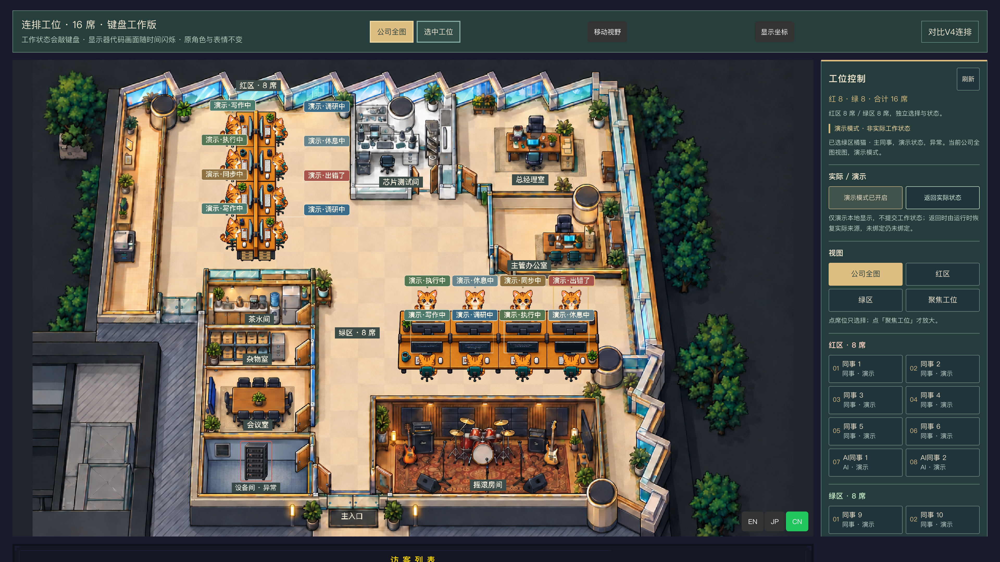

# Star Office UI 6.0.0



Star Office UI 是一个独立维护的实时 AI 协作办公室与状态可视化平台。当前版本采用完整的前后端重写，包含 16 席像素办公室、Flask 服务、可选桌面壳、Sub2API 用户遥测集成和可复现的离线发布工具。

这是 `hereww/Star-Office-UI` 的正式工程仓库。项目结构、运行时边界和部署流程均以当前代码为准。

## 当前能力

- 16 席办公室地图，支持四向角色、固定坐姿、屏幕特效、状态气泡和移动端布局。
- Flask 后端提供员工入口、管理入口、配置 API、状态快照和运行时资源路由。
- 独立 collector 从 Sub2API 只读采集用户遥测，并将结果投影为办公室快照。
- `integrations/sub2api/` 保存 Sub2API 宿主源码、用户遥测插件、插件 UI、迁移、补丁和 `.s2plugin` 打包验签工具。
- Electron 和 Tauri 桌面壳复用同一个 Python 后端，可独立开发和构建。
- 离线发布包、Docker Compose、Nginx/TLS、备份和回滚脚本集中在 `deploy/office/`。

## 一键部署包

需要把项目交付到互联网主机或不能联网的内网主机时，使用独立的 Quickstart 包：

```bash
# 构建带 Linux CPython 3.11 wheelhouse 的可复制归档
python scripts/package_deploy_bundle.py \
  --output deploy/bundles \
  --bundle-id star-office-ui-6.0.0 \
  --wheelhouse deploy/office/wheelhouse/linux-cp311-x86_64

# 解包后，联网 Docker 主机一条命令启动
./deploy/quickstart/install.sh --online --docker

# 内网离线 Docker 主机一条命令启动
./deploy/quickstart/install.sh --offline --docker
```

Quickstart 同时支持没有 Docker 的原生 Python 安装（`--online --native` / `--offline --native`）。离线 Docker 构建需要目标机预缓存与架构匹配的 `python:3.11-slim`，也可以在交付包中附带 `docker save` 生成的镜像归档；安装脚本不会在离线模式下访问 PyPI、拉取镜像或覆盖已有数据。正式办公室生产入口仍使用 [`deploy/office/README.md`](./deploy/office/README.md) 中的证书、凭据、预检和回滚流程。

## 快速运行

要求 Python 3.10+：

```bash
git clone https://github.com/hereww/Star-Office-UI.git
cd Star-Office-UI
python3 -m venv .venv
. .venv/bin/activate
python -m pip install -r backend/requirements.txt
cp state.sample.json state.json
python backend/app.py
```

打开 `http://127.0.0.1:19000/`。可以在另一个终端切换状态：

```bash
python set_state.py writing "正在整理文档"
python set_state.py syncing "同步进度中"
python set_state.py idle "待命中"
```

要预览当前重写的办公室入口，显式开启 office 模式：

```bash
export OFFICE_ENABLED=1
export OFFICE_RELEASE_ID=office-v1-dev
export STAR_OFFICE_DATA_DIR="$PWD/.local/dev-data"
export FLASK_SECRET_KEY="replace-with-a-random-value-at-least-24-chars"
export ASSET_DRAWER_PASS="replace-with-a-strong-password"
python backend/app.py
```

开发服务器只用于本机验证。正式部署必须使用 [`docs/DEPLOYMENT.md`](./docs/DEPLOYMENT.md) 中的离线构建、预检、TLS、备份和回滚流程。

## 验证

```bash
python -m compileall -q backend scripts
python scripts/test_office_release.py
PYTHONDONTWRITEBYTECODE=1 python -m unittest discover -s integrations/sub2api/plugin-tools/tests -v

cd integrations/sub2api/host-source/backend
go test ./cmd/user-telemetry-plugin/...
node --test cmd/user-telemetry-plugin/ui/bridge.test.cjs cmd/user-telemetry-plugin/ui/bridge-http-compat.test.cjs
```

本地发布测试不连接生产 Sub2API、Docker、Nginx 或真实用户数据。生产验收需要额外的目标主机、证书、凭据和回滚证据。

## 文档入口

- [`docs/PROJECT_STRUCTURE.md`](./docs/PROJECT_STRUCTURE.md)：目录职责、组件关系、运行时数据和源码边界。
- [`docs/SYSTEM_DEPLOYMENT.md`](./docs/SYSTEM_DEPLOYMENT.md)：Sub2API、用户遥测插件、Star Office UI 和 Collector 的完整系统部署顺序。
- [`docs/SUB2API_DEPLOYMENT.md`](./docs/SUB2API_DEPLOYMENT.md)：Sub2API 主服务、PostgreSQL、Redis 的联网/离线安装。
- [`docs/SUB2API_PLUGIN_DEPLOYMENT.md`](./docs/SUB2API_PLUGIN_DEPLOYMENT.md)：插件验签、宿主兼容性、安装、凭据和回滚。
- [`docs/DEPLOYMENT.md`](./docs/DEPLOYMENT.md)：Star Office UI 本地开发、Quickstart、正式办公室发布、Nginx/TLS、备份和回滚。
- [`integrations/sub2api/README.md`](./integrations/sub2api/README.md)：Sub2API 宿主、用户遥测插件和打包验签工具。
- [`deploy/office/README.md`](./deploy/office/README.md)：办公室发布包的详细运维约束。
- [`frontend/office/README.md`](./frontend/office/README.md)：新版办公室前端契约和资源加载边界。

## 源码结构

```text
Star-Office-UI/
├── backend/                 Flask 主服务、办公室 API、collector 和存储
├── frontend/                前端页面、V4/V5 办公室运行时和本地资源
├── integrations/sub2api/    Sub2API 宿主源码、遥测插件和打包工具
├── deploy/office/            离线发布、Compose、预检、备份和回滚
├── desktop-pet/              Tauri 桌面壳
├── electron-shell/           Electron 桌面壳
├── scripts/                  测试、素材检查和发布打包脚本
├── assets/                   设计素材和 QA 资料
├── docs/                     架构、契约、验收和部署文档
├── VERSION                   当前版本号
└── LICENSE                   Star Office UI 项目许可
```

## 安全与发布边界

真实密钥、OAuth 凭据、消费 token、管理员密码哈希、CA 私钥、SQLite、快照和运行时配置不进入仓库。Sub2API 集成副本中的上游 OAuth 值使用 `REDACTED_*` 占位符，生产环境必须通过受控配置注入。

`deploy/office/out/` 中的候选归档和解包目录只属于本地发布工作区，不作为源码提交。正式发布使用新的不可变 release ID，并保留校验值和可验证回滚材料。

## 许可

Star Office UI 根项目遵循根目录 [`LICENSE`](./LICENSE)。`integrations/sub2api/host-source/` 保留 Sub2API 上游的许可证和声明；使用该目录时同时遵守其中的许可证要求。
